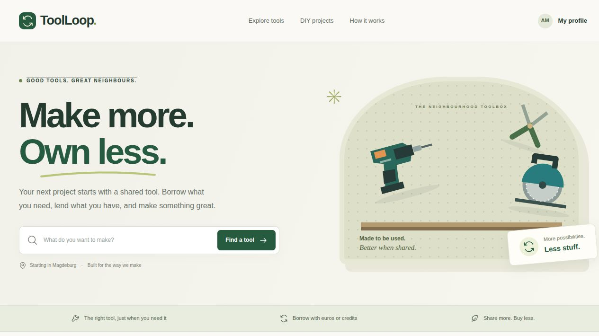
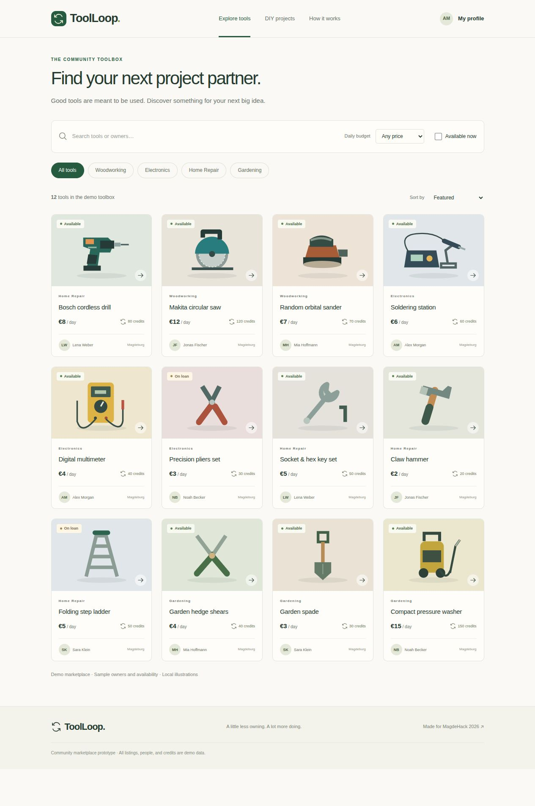
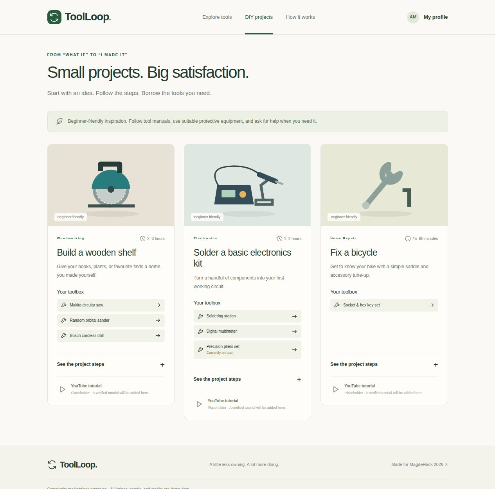

# ToolLoop

### Make more. Own less.

**[Explore the live demo](https://toolloop-axis.vercel.app/)** · [Judge walkthrough](docs/DEMO.md) · [Screenshots](docs/screenshots/README.md)

A drill for one shelf. A soldering iron for one weekend. Buying equipment for occasional projects can be expensive, and useful tools often sit idle between jobs. ToolLoop explores a community marketplace where students, hobbyists, and makers can find tools to borrow or rent instead of buying their own.

Created during **MagdeHack 2026**, ToolLoop connects project ideas with the equipment needed to get started.



## How it works

1. **Discover community tools.** Browse 12 sample listings across Woodworking, Electronics, Home Repair, and Gardening. Search by tool or owner, filter by category, daily budget, or availability, and sort by price or credits.
2. **Find equipment for a project.** Open a listing to see its description, included equipment, sample owner, availability, and daily cost.
3. **Follow a DIY guide.** Explore three beginner projects—building a wooden shelf, soldering an electronics kit, and fixing a bicycle—with written steps and links to matching tools.
4. **Preview borrowing.** Choose a duration and euros or credits on the published prototype, then see a local confirmation. No request is sent or booked.
5. **Explore community credits.** The proposed system would reward sharing tools with credits that could support future borrowing. Current balances and costs are illustrative, with no monetary value.

## What is implemented?

| Area | Published Vercel prototype | Current local checkout |
| --- | --- | --- |
| Marketplace | Search, filters, sorting, and 12 mock tool listings | Same discovery features |
| Projects | Three written guides linked to marketplace tools | Adds a shortcut to Sam’s drill from the shelf project |
| Borrowing | In-memory request preview; no saved booking | Adds a browser-local request → approval → completion demo for Sam’s drill |
| Profile and credits | Fictional sample profile and static balance/history | Alex/Sam user switcher, completion-only credit updates, and Reset Demo |
| Persistence | No real accounts or shared records | The shelf demo persists in this browser’s localStorage |

The published site and local checkout were inspected on **14 November 2026**. The interactive Alex/Sam extension is present locally but was **not on the live site** at that time. See the [walkthrough](docs/DEMO.md) for the appropriate demo path.

**Demo boundaries:** all listings, people, prices, availability, and credits are simulated. There are no real payments, authentication, database-backed bookings, owner messages, or credit transfers. YouTube tutorial slots are explicitly marked placeholders; verified videos have not been added.

## A look inside

| Tool discovery | Project guides |
| --- | --- |
|  |  |

These are real captures of the deployed website. [Capture details and source pages](docs/screenshots/README.md).

## Technology

| Technology | Role |
| --- | --- |
| Next.js App Router + React | Pages, layouts, and interactive components |
| TypeScript | Shared data models and application logic |
| Tailwind CSS + custom CSS | Responsive styling and a consistent visual language |
| Vercel | Hosting for the published frontend |

Tool and project records live in local mock data. A small read-only data adapter keeps future Supabase integration separate from the UI. Tool illustrations are local SVGs, so listing images do not rely on remote image services.

## Run locally

Prerequisites: **Node.js 20.9 or newer** and **npm**.

```bash
git clone https://github.com/ThatStookie/toolloop.git
cd toolloop
npm ci
npm run dev
```

Open [localhost:3000](http://localhost:3000). No API keys, database setup, or environment variables are required for the prototype. Your checked-out revision determines whether the Alex/Sam extension is available.

```bash
npm run lint
npm run build
npm start
```

The current local checkout also provides `npm run test:demo` for its borrowing state-transition tests. See [local demo instructions](docs/DEMO.md#local-alexsam-credits-extension) for the complete flow.

## Project structure

```text
app/          Pages, layout, and global styles
components/   Reusable marketplace UI and demo interactions
lib/          Types, mock data, data adapter, and local demo rules
tests/        Borrowing demo tests in the current local checkout
docs/         Judge walkthrough and authentic website screenshots
```

## Roadmap

- Add Supabase-backed listings, accounts, and ownership controls.
- Introduce real availability, borrowing requests, and return tracking.
- Validate the credit rules and implement a server-enforced ledger.
- Add reviewed tutorial links and test the borrowing experience with community members.

These are future plans, not capabilities of the current prototype.

## Team

Built by a two-person team during MagdeHack 2026.

| Team member | GitHub |
| --- | --- |
| [Team member 1 name — to be added] | [GitHub username — to be added] |
| [Team member 2 name — to be added] | [GitHub username — to be added] |
