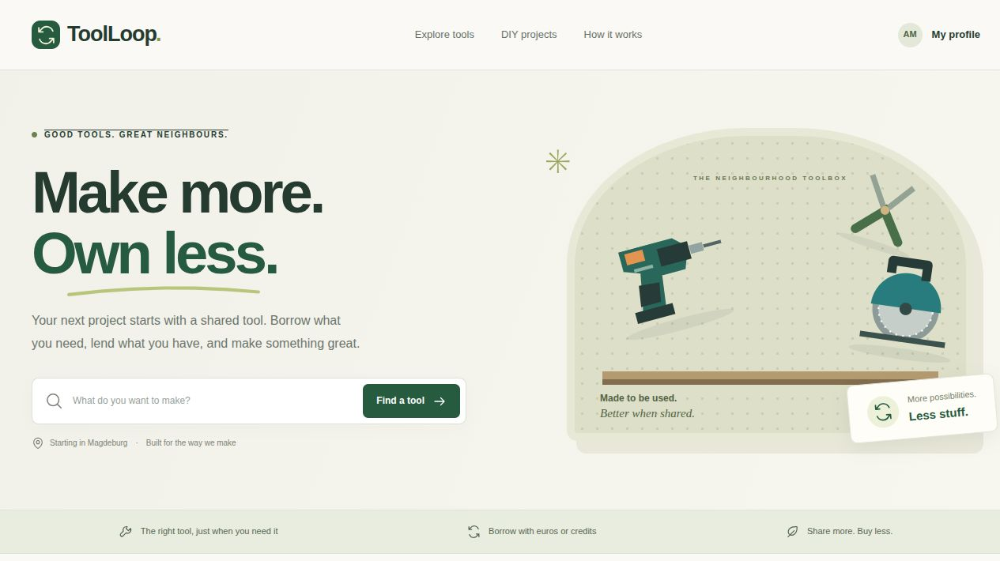
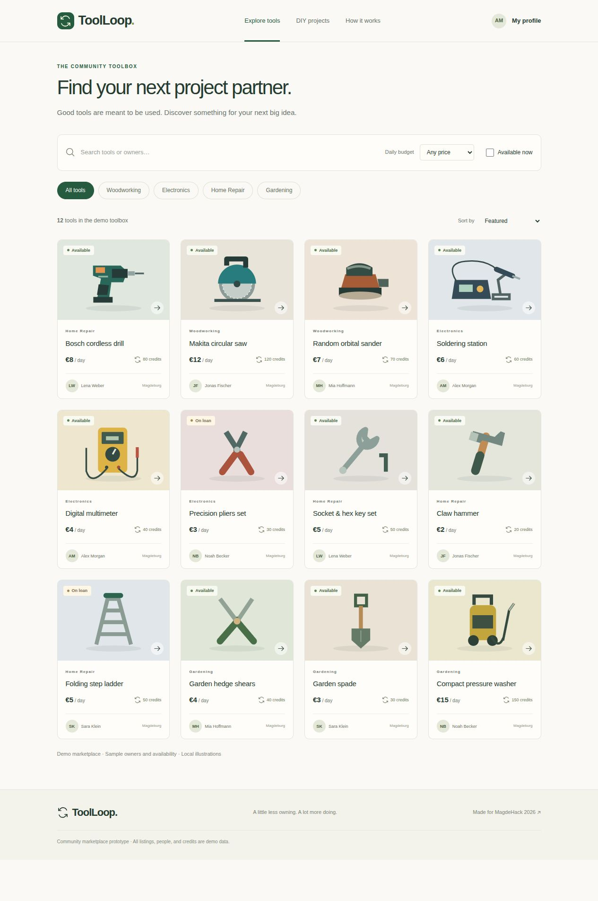
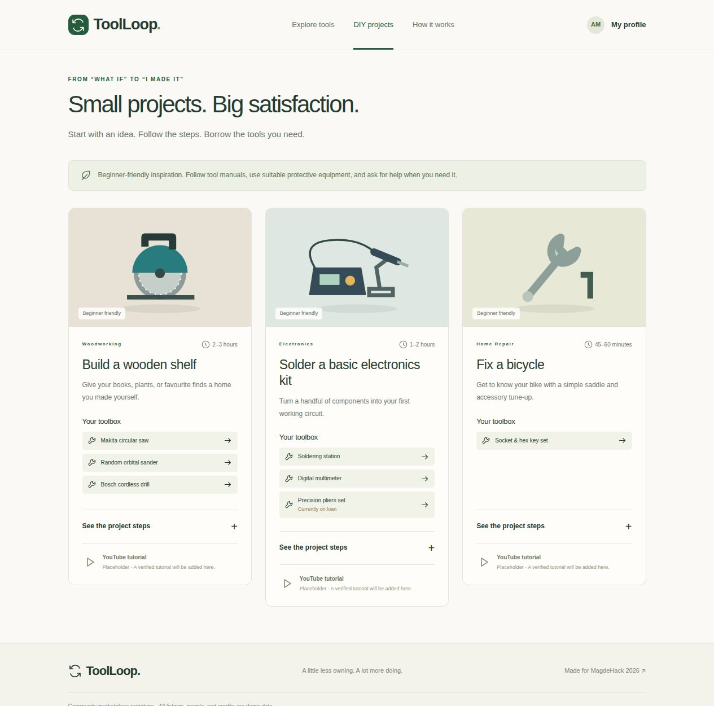

# Website screenshots

[Back to project README](../../README.md)

These JPEGs were captured directly from the live ToolLoop website on **14 November 2026**, using a browser. They show the deployed prototype, not the newer local Alex/Sam credits extension. No screenshots were generated, composited, retouched, or populated with invented UI.

| File | Source page | Capture |
| --- | --- | --- |
| [homepage.jpg](homepage.jpg) | [Homepage](https://toolloop-axis.vercel.app/) | Browser-captured crop showing navigation, hero, search, and value strip |
| [explore.jpg](explore.jpg) | [Explore tools](https://toolloop-axis.vercel.app/explore) | Full page with default filters and 12 sample listings |
| [projects.jpg](projects.jpg) | [DIY projects](https://toolloop-axis.vercel.app/projects) | Full page with the three project cards and collapsed written instructions |

The tool artwork visible within the screenshots is the website’s existing SVG illustration system. It is not tool photography or evidence of real inventory.

## Homepage

## Explore

## Projects

